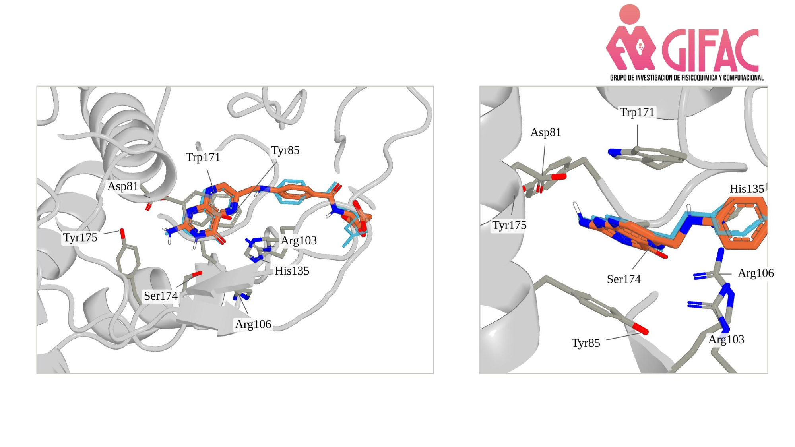

# Adsorption geometry of folic acid and pterin-6-carboxylic acid on Au(111)

Data and scripts for the paper:

> D. Aragón Giraldo, P. S. Cappellari, D. Blach, C. C. Villa.
> *Adsorption Geometry of Folic Acid and Pterin-6-Carboxylic Acid on Au(111): Implications
> for Folate Receptor α Recognition.*

The study asks why gold nanoparticles conjugated with folic acid (FA) are recognized by
folate receptor α (FRα) while those conjugated with pterin-6-carboxylic acid (PCA) are not,
and answers it with periodic DFT, excited-state calculations, molecular docking and
molecular dynamics. This repository holds the inputs, raw numerical results and analysis
scripts behind every table and figure.



*PCA can adopt the same binding mode as FA inside the folate pocket of FRα: the two
ligands superimpose on the pterin ring and reach the same anchoring residues. What
separates them is not recognition in solution but the orientation each ligand is left
in once it adsorbs on gold.*

## What is here

| Folder | Content |
| --- | --- |
| `DFT/` | Quantum ESPRESSO inputs at the optimized geometry for each adsorption configuration. One directory per configuration, with the three single-point calculations used for the frozen-fragment adsorption energy: `A` (complex), `B` (slab) and `C` (ligand). The four FA directories from the first series use the older names `*_SCF.in`, `Slab.in` and `Mol.in` for the same three calculations. |
| `TDDFT/` | ORCA inputs and Cartesian coordinates of the seven excited-state models: PCA free, adsorbed and with the Au₁₆ cluster, in the neutral and dianionic forms, plus the bare cluster. |
| `docking/` | Docked poses of PCA and the robustness runs of FA (`robustez_FA.csv`) and PCA (`robustez_PCA.csv`) over eight receptor chains and six random seeds. |
| `MD/` | Final configurations of the Au(111) trajectories at 200 ns and the GROMACS parameter files (`mdp/`) for minimization, NVT, NPT and production, for both the receptor and the surface systems. |
| `data/Au_MD/` | Per-frame time series of the nine Au(111) trajectories: height of each ligand fragment above the nearest gold face and the tilt angle of the pterin ring. |
| `data/FRa_PCA/` | Per-frame time series of the six FRα–PCA trajectories. |
| `exp/` | Emission spectra of the free ligands and of the gold conjugates at pH 10, measured by Blach et al. and used for the quenching reported in Section 3.3. |
| `scripts/` | Analysis and set-up scripts: the DFT pipeline, the post-processing of densities and charges, the docking protocol and the trajectory analysis. |
| `figures/` | Scripts that generate each figure of the paper, one archive per figure. |

## Reproducing the adsorption energies

The adsorption energy is defined with frozen fragments,

```
ΔE_ads = E(A) − E(B) − E(C)
```

where `B` (clean slab) and `C` (isolated ligand) are evaluated in the adsorbed geometry and
in the same cell as `A`. The quantity is therefore an interaction energy: it excludes the
deformation energy of the fragments. Running the three inputs of any `DFT/` directory and
subtracting as above reproduces the corresponding row of Table 1.

The dispersion term of Table S3 is read from the `DFT-D3 Dispersion` line of each output and
combined in the same way.

## Software

| | |
| --- | --- |
| Quantum ESPRESSO | 7.2 — PBE, D3 with Becke–Johnson damping, 60/600 Ry cutoffs, 4×4×1 k-mesh |
| ORCA | 6.1.1 — TDA-CAM-B3LYP/def2-SVP, def2-ECP on Au, CPCM water |
| GROMACS | 2024.4 — INTERFACE force field for Au, GAFF2/AM1-BCC for the ligands, ff14SB, TIP3P |
| AutoDock Vina | 1.2.7 |

## A note on the gold slab

An error was found, after the calculations were complete, in the two frozen bottom layers of
the slab used for the FA systems: six Au atoms were displaced from their lattice positions.
Those layers are held fixed and the slab enters the adsorption energy twice, in `E(A)` and in
`E(B)`, so the error cancels. One configuration was recomputed with a corrected slab
(`DFT/FAfix_*`): ΔE_ads moved from −0.944 to −0.947 eV, a difference of 3 meV, and the
dispersion share was unchanged. The published values are those of the original series, and
both series are included here so the comparison can be checked.

## License

Scripts are released under the MIT License (`LICENSE`). Data files are released under
[CC BY 4.0](https://creativecommons.org/licenses/by/4.0/).

## Acknowledgement

This work used computational resources provided by UNC Supercómputo (CCAD), Universidad
Nacional de Córdoba, Argentina, within the framework of the Programa Sistema Nacional de
Infraestructuras de Investigación Científico-Tecnológica (SNIICTs). In particular, it used
resources from the Helvetios cluster, donated by the École Polytechnique Fédérale de
Lausanne (EPFL) to the Universidad Nacional de Córdoba (UNC) and operated by UNC
Supercómputo (CCAD).
